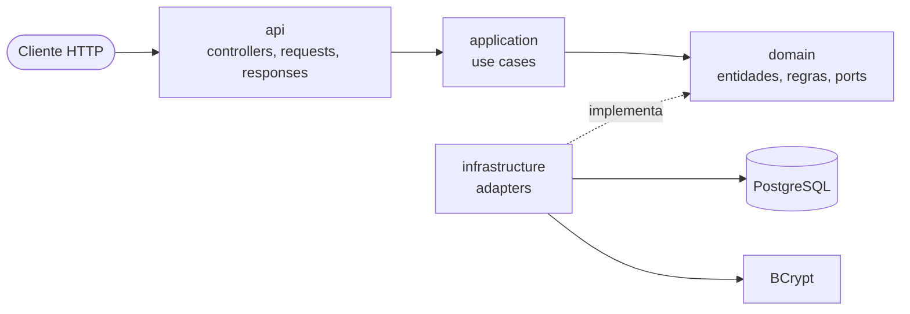

# task-api

API REST de gerenciamento de tarefas, com cadastro de usuários e autenticação JWT.

[](https://github.com/FRSContiero/task-api/actions/workflows/ci.yml)


> Em desenvolvimento. Já disponível: cadastro, login, refresh, logout e troca de senha. Próxima etapa: tarefas.

## Arquitetura

Código organizado por feature (`user`, `auth` e, em breve, `task`), com camadas dentro de cada uma. Os use cases dependem só de ports (interfaces do domínio); a infraestrutura implementa esses ports com adapters, então regra de negócio não conhece JPA nem Spring Security.



## Stack

- Java 25, Spring Boot 4.2, Maven (wrapper)
- Spring Security 7 (resource server JWT, HS256)
- PostgreSQL 18 + Flyway
- JUnit 5, Mockito, AssertJ, Testcontainers
- springdoc-openapi (Swagger UI)

## Como rodar localmente

Pré-requisitos: JDK 25 e Docker em execução.

```bash
git clone git@github.com:FRSContiero/task-api.git
cd task-api
./mvnw spring-boot:run        # PowerShell: .\mvnw.cmd spring-boot:run
```

O `spring-boot:run` ativa o perfil `dev`, que sobe o PostgreSQL do `compose.yaml` sozinho e usa um segredo JWT de desenvolvimento. A API fica em `http://localhost:8080`.

Fora do perfil `dev`, a variável de ambiente `JWT_SECRET` (mínimo de 32 caracteres) é obrigatória; sem ela a aplicação não sobe.

## API

Swagger UI (somente no perfil `dev`): http://localhost:8080/swagger-ui.html

| Método | Rota | Descrição | Autenticação |
|---|---|---|---|
| POST | `/api/auth/register` | Cadastra um usuário | Não |
| POST | `/api/auth/login` | Autentica e emite access token e refresh token | Não |
| POST | `/api/auth/refresh` | Troca o refresh token por um novo par | Não |
| POST | `/api/auth/logout` | Revoga o refresh token | Bearer JWT |
| GET | `/api/users/me` | Retorna o usuário autenticado | Bearer JWT |
| PUT | `/api/users/me/password` | Troca a senha e encerra todas as sessões | Bearer JWT |

Erros seguem o formato `ProblemDetail` (RFC 9457). Regras de negócio, fluxos e configuração em detalhe: [docs/MANUAL.md](docs/MANUAL.md).

## Testes

```bash
./mvnw test     # unitários
./mvnw verify   # unitários + integração (precisa do Docker)
```

Entidades e use cases têm testes unitários sem Spring, com fakes em memória dos ports. Controllers são testados com `@WebMvcTest`, incluindo a configuração de segurança real. Adapters e fluxos ponta a ponta rodam contra um PostgreSQL real via Testcontainers.

## Decisões técnicas

- **JWT com o resource server do Spring Security, sem biblioteca extra** — a validação e a geração de tokens já vêm com o Nimbus incluído no Spring — trade-off: chave simétrica (HS256); se outro serviço precisar validar tokens sem conhecer o segredo, será preciso migrar para RS256.
- **Ports para persistência e hash de senha** (`UserRepository`, `PasswordHasher`) — os use cases são testados sem banco e sem Spring — trade-off: entidades JPA ficam no `domain`, sem camada de mapeamento.
- **Email como value object** (`Email`), normalizado em minúsculas — cadastro e futuras buscas por email não diferenciam maiúsculas — trade-off: precisa de um `AttributeConverter` para o JPA.
- **Unicidade de email garantida no banco** — a checagem prévia no use case dá a mensagem certa no caso comum, e a constraint `uk_users_email` cobre cadastros simultâneos, traduzida para 409 em `JpaUserRepository`.
- **Refresh token opaco, guardado só como hash e rotacionado a cada uso** — permite logout real e detecta vazamento: se um token já trocado volta a ser usado, todas as sessões do usuário são revogadas (`RefreshTokensUseCase`) — trade-off: uma consulta ao banco a cada refresh e uma tabela a mais.
- **Troca de senha na feature `auth`, não em `user`** — ela precisa encerrar as sessões; em `user`, as duas features dependeriam uma da outra — trade-off: a rota `/api/users/me/password` é atendida pelo `AuthController`.
- **IDs UUID gerados na aplicação** — o id existe antes de salvar e não expõe contagem de registros — trade-off: o campo `@Version` também é usado pelo Spring Data para saber que a entidade é nova.

## Próximos passos

- CRUD de tarefas e listagem com filtros
- Limpeza periódica de refresh tokens expirados
