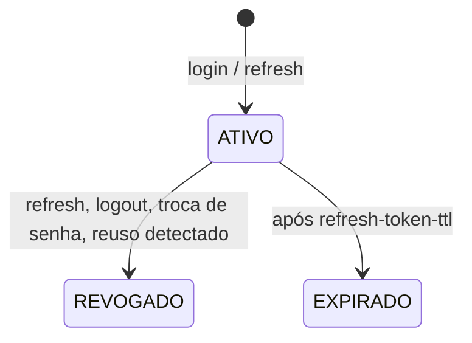
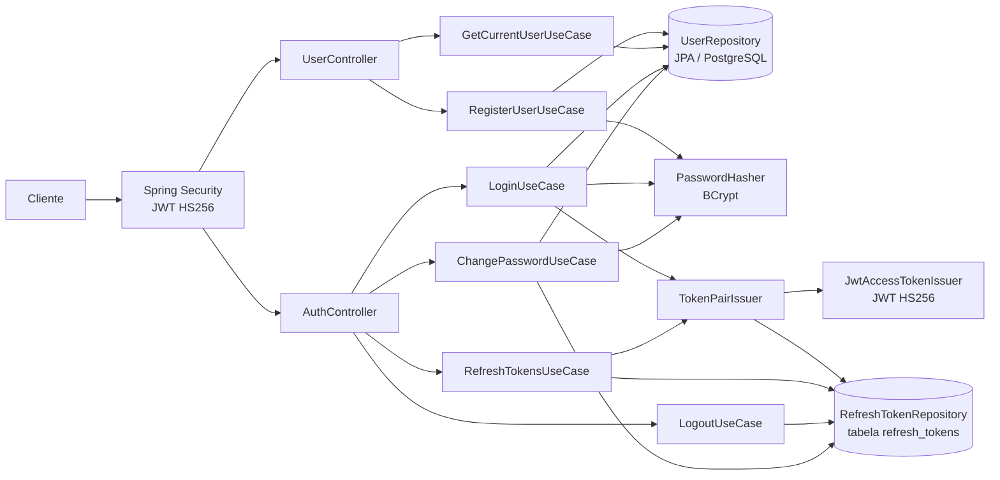

# Manual — task-api

> Última atualização: 2026-11-26 · c66f2c1 (+ alterações não commitadas da branch `feat/auth`)

## 1. Visão geral

API REST de gerenciamento de tarefas com autenticação JWT. Cada usuário gerencia apenas as próprias tarefas. **Hoje estão implementados cadastro de usuário, login, renovação (refresh) e encerramento (logout) de sessão, troca de senha e a consulta do usuário autenticado**; o gerenciamento de tarefas está planejado (ver CLAUDE.md, seção Domínio) e ainda não existe no código.

Conceitos centrais: *usuário* (nome, email único, senha com hash BCrypt), *token de acesso* (JWT HS256 enviado como `Authorization: Bearer`) e *refresh token* (valor opaco usado para obter um novo par de tokens).

O contrato campo a campo está no Swagger UI (`/swagger-ui.html`, disponível só no perfil `dev`).

## 2. Como usar

### Cadastrar um usuário

```bash
curl -i -X POST http://localhost:8080/api/auth/register \
  -H 'Content-Type: application/json' \
  -d '{"name":"Maria Souza","email":"Maria.Souza@Example.com","password":"s3nha-segura"}'
```

Resposta `201` com `Location: /api/users/me` e o corpo (email devolvido em minúsculas, sem senha):

```json
{ "id": "3f6c2a9e-8d1b-4c7a-9f0e-2b5d6a7c8e91", "name": "Maria Souza",
  "email": "maria.souza@example.com", "createdAt": "2026-11-26T14:30:00Z" }
```

### Consultar o usuário autenticado

```bash
curl -i http://localhost:8080/api/users/me -H 'Authorization: Bearer <token>'
```

### Entrar (login)

```bash
curl -i -X POST http://localhost:8080/api/auth/login \
  -H 'Content-Type: application/json' \
  -d '{"email":"maria.souza@example.com","password":"s3nha-segura"}'
```

Resposta `200`:

```json
{ "accessToken": "<jwt>", "tokenType": "Bearer", "expiresIn": 900, "refreshToken": "<valor-opaco>" }
```

Use `accessToken` no cabeçalho `Authorization: Bearer` e guarde o `refreshToken`.

### Renovar a sessão

```bash
curl -i -X POST http://localhost:8080/api/auth/refresh \
  -H 'Content-Type: application/json' -d '{"refreshToken":"<valor-opaco>"}'
```

Devolve um novo par de tokens (mesmo formato do login). O refresh token enviado deixa de valer: use sempre o novo.

### Sair (logout)

```bash
curl -i -X POST http://localhost:8080/api/auth/logout -H 'Authorization: Bearer <token>' \
  -H 'Content-Type: application/json' -d '{"refreshToken":"<valor-opaco>"}'
```

Resposta `204`.

### Trocar a senha

```bash
curl -i -X PUT http://localhost:8080/api/users/me/password -H 'Authorization: Bearer <token>' \
  -H 'Content-Type: application/json' \
  -d '{"currentPassword":"s3nha-segura","newPassword":"n0va-s3nha-segura"}'
```

Resposta `204`. Todas as sessões (refresh tokens) do usuário são encerradas; é preciso fazer login de novo.

## 3. Funcionalidades

### Cadastrar usuário

**O que faz:** cria um usuário com nome, email e senha.

**Como usar:** `POST /api/auth/register` (público; Swagger, tag "Usuários").

**Regras de negócio:**
- Nome obrigatório, até 100 caracteres; espaços nas pontas são removidos — `RegisterUserRequest`, `User#User`
- Email obrigatório, formato válido, até 254 caracteres — `RegisterUserRequest`
- Email é normalizado (trim + minúsculas) antes de qualquer consulta ou gravação — `Email`
- Email é único; consulta prévia retorna 409 — `RegisterUserUseCase#execute`
- Cadastros simultâneos com o mesmo email: a restrição única `uk_users_email` do banco é a garantia final e também resulta em 409 — `JpaUserRepository#save`
- Senha obrigatória, 8 a 72 caracteres (limite do BCrypt) — `RegisterUserRequest`
- A senha é gravada somente como hash BCrypt; a resposta nunca a expõe (nem o hash) — `BCryptPasswordHasher`, `UserResponse`
- `id` é um UUID gerado pela aplicação; `createdAt` vem do relógio do servidor (UTC) — `User#register`, `RegisterUserUseCase`

**Erros** (corpo no formato ProblemDetail, RFC 9457):

| Status | Quando |
|---|---|
| 400 | Campo ausente, em branco, fora dos limites ou email inválido |
| 409 | Email já cadastrado (inclusive em cadastros concorrentes) |

**Eventos e integrações:** nenhum.

### Consultar usuário autenticado

**O que faz:** devolve id, nome, email e data de criação do dono do token.

**Como usar:** `GET /api/users/me` com `Authorization: Bearer <token>` (Swagger, tag "Usuários").

**Regras de negócio:**
- O usuário é identificado pelo `sub` do JWT, que deve ser um UUID — `UserController#me`
- Token ausente, inválido (assinatura) ou expirado é rejeitado pela segurança antes do controller — `SecurityConfig#securityFilterChain`
- Se o usuário do token não existe mais, retorna 404 — `GetCurrentUserUseCase#execute`

**Erros:**

| Status | Quando |
|---|---|
| 401 | Token ausente, inválido ou expirado |
| 404 | Usuário do token não existe mais |

**Eventos e integrações:** nenhum.

### Login

**O que faz:** autentica com email e senha e emite um par de tokens (acesso + refresh).

**Como usar:** `POST /api/auth/login` (público; Swagger, tag "Autenticação").

**Regras de negócio:**
- O email é normalizado (trim + minúsculas), então a caixa não importa; formato inválido ou campo em branco gera 400 — `LoginRequest`, `Email`
- Email inexistente e senha errada retornam 401 com a mesma mensagem ("Invalid email or password") — `InvalidCredentialsException`
- Quando o email não existe, um hash BCrypt é calculado mesmo assim, para o tempo de resposta não revelar se o email está cadastrado — `LoginUseCase#execute`
- Token de acesso: JWT HS256, `sub` = id do usuário, validade `app.jwt.access-token-ttl` (15m); `expiresIn` é informado em segundos (900) — `JwtAccessTokenIssuer#issueFor`, `TokenResponse`
- Refresh token: valor aleatório opaco de 256 bits, validade `app.jwt.refresh-token-ttl` (7d); só o hash SHA-256 é gravado no banco — `OpaqueTokens`, `TokenPairIssuer#issueFor`, `RefreshToken#issue`

**Erros:**

| Status | Quando |
|---|---|
| 400 | Email inválido/ausente ou senha em branco |
| 401 | Email ou senha incorretos |

**Eventos e integrações:** nenhum.

### Renovar tokens (refresh)

**O que faz:** troca um refresh token válido por um novo par de tokens, com rotação.

**Como usar:** `POST /api/auth/refresh` (público; Swagger, tag "Autenticação"), corpo `{"refreshToken": "..."}`.

**Regras de negócio:**
- Token desconhecido, expirado ou revogado retorna 401 — `RefreshTokensUseCase#execute`
- Rotação: o token usado é revogado e um novo par é emitido — `RefreshTokensUseCase#execute`, `RefreshToken#revoke`
- Reuso de um token já revogado (rotacionado) é tratado como vazamento: todos os refresh tokens ativos do usuário são revogados, um `warn` com o id do usuário é registrado e a resposta é 401; essa revogação é confirmada mesmo com a requisição falhando — `RefreshTokensUseCase#execute` (`noRollbackFor`)
- Dois refreshes simultâneos com o mesmo token: um deles falha com 409 (lock otimista pela coluna `version`) — `RefreshToken`, `GlobalExceptionHandler#handleConcurrentUpdate`

**Estados do refresh token:**


**Erros:**

| Status | Quando |
|---|---|
| 400 | `refreshToken` ausente ou em branco |
| 401 | Token desconhecido, expirado ou revogado |
| 409 | Mesmo token usado em requisições simultâneas |

**Eventos e integrações:** nenhum.

### Logout

**O que faz:** revoga o refresh token informado.

**Como usar:** `POST /api/auth/logout` com `Authorization: Bearer <token>` e corpo `{"refreshToken": "..."}` (Swagger, tag "Autenticação").

**Regras de negócio:**
- Só revoga se o token pertencer ao usuário autenticado; token desconhecido, já revogado ou de outro usuário é ignorado — `LogoutUseCase#execute`
- Sempre responde 204 (idempotente), para não revelar se o token existe — `LogoutUseCase`
- O token de acesso continua válido até expirar (JWT sem estado; não há lista de revogação) — `SecurityConfig`

**Erros:**

| Status | Quando |
|---|---|
| 400 | `refreshToken` ausente ou em branco |
| 401 | Token de acesso ausente, inválido ou expirado |

**Eventos e integrações:** nenhum.

### Trocar senha

**O que faz:** altera a senha do usuário autenticado e encerra todas as suas sessões.

**Como usar:** `PUT /api/users/me/password` com `Authorization: Bearer <token>` e corpo `{"currentPassword": "...", "newPassword": "..."}` (Swagger, tag "Autenticação").

**Regras de negócio:**
- Nova senha obrigatória, 8 a 72 caracteres; senha atual obrigatória — `ChangePasswordRequest`
- Senha atual incorreta retorna 422 — `ChangePasswordUseCase#execute`, `IncorrectCurrentPasswordException`
- A nova senha é gravada como hash BCrypt — `User#changePassword`
- Em caso de sucesso, todos os refresh tokens ativos do usuário são revogados na mesma transação — `ChangePasswordUseCase#execute`
- Tokens de acesso já emitidos continuam válidos até expirar

**Erros:**

| Status | Quando |
|---|---|
| 400 | Campo ausente/em branco ou nova senha fora de 8–72 caracteres |
| 401 | Token de acesso ausente, inválido ou expirado |
| 404 | Usuário do token não existe mais |
| 422 | Senha atual incorreta |

**Eventos e integrações:** nenhum.

### Tarefas (planejado)

Criação, listagem e conclusão de tarefas por usuário estão previstas, mas não existem no código.

## 4. Funcionamento interno

Organização por feature (`user` e `auth`) com camadas `api`, `application`, `domain` e `infrastructure`; código compartilhado em `shared`.



- **Segurança** (`SecurityConfig`): sem estado (sem sessão), CSRF desabilitado, JWT validado como resource server. Rotas públicas: `POST /api/auth/register`, `POST /api/auth/login`, `POST /api/auth/refresh`, `GET` de Swagger/api-docs e `/actuator/health`, e `/error`. Todo o resto exige token.
- **Erros** (`GlobalExceptionHandler`): exceções de domínio estendem `NotFoundException` (404), `ConflictException` (409) ou `BusinessRuleException` (422); `UnauthorizedException` (401) é a base de `InvalidCredentialsException` e `InvalidRefreshTokenException`; `OptimisticLockingFailureException` (conflito de versão) vira 409; validação de entrada gera 400.
- **Persistência:** `spring.jpa.hibernate.ddl-auto=validate`; o esquema vem exclusivamente das migrations Flyway. Lock otimista via coluna `version`.
- **Sessões:** o access token é stateless; o refresh token fica em `refresh_tokens` apenas como hash SHA-256 (`uk_refresh_tokens_token_hash`), com `expires_at` e `revoked_at`. Não há job de limpeza de tokens expirados (o README lista como próximo passo).
- Sem mensageria, jobs agendados ou integrações externas.

## 5. Configuração

| Variável / propriedade | Para que serve | Default | Obrigatória |
|---|---|---|---|
| `JWT_SECRET` (`app.jwt.secret`) | Segredo de assinatura HS256; mínimo 32 caracteres, senão a aplicação não sobe | nenhum (no perfil `dev` há um segredo de desenvolvimento) | Sim, fora do `dev` |
| `app.jwt.access-token-ttl` | Validade do token de acesso | `15m` | Não |
| `app.jwt.refresh-token-ttl` | Validade do refresh token (usada na emissão do refresh token) | `7d` | Não |
| `springdoc.api-docs.enabled` | Expõe `/v3/api-docs` | `false` (`true` no `dev`) | Não |
| `springdoc.swagger-ui.enabled` | Expõe `/swagger-ui.html` | `false` (`true` no `dev`) | Não |

**Perfis:**
- `dev`: ativado automaticamente por `./mvnw spring-boot:run`; define um segredo JWT de desenvolvimento (nunca usar fora do ambiente local) e habilita Swagger e api-docs.
- Sem perfil (padrão/produção): `JWT_SECRET` obrigatório; Swagger e api-docs desligados.

## 6. Operação

- **Subir:** `./mvnw spring-boot:run` (sobe o `compose.yaml` e ativa o perfil `dev`). Só dependências: `docker compose up -d`.
- **Banco:** PostgreSQL 18 (`compose.yaml`, serviço `postgres`, banco/usuário `taskapi`; a porta 5432 do contêiner é publicada em porta aleatória do host).
- **Migrations:** Flyway executa na inicialização. `V1__create_users.sql` cria a tabela `users` (id UUID, name, email, password_hash, created_at, version) com a restrição única `uk_users_email`. `V2__create_refresh_tokens.sql` cria `refresh_tokens` (id, user_id com `ON DELETE CASCADE`, token_hash único, expires_at, revoked_at, created_at, version) e o índice `idx_refresh_tokens_user_id`.
- **Problemas comuns:**
  - Falha na inicialização por `app.jwt.secret` inválido: defina `JWT_SECRET` com 32+ caracteres (ou rode com o perfil `dev` localmente).
  - Log `WARN` "Refresh token reuse detected for user <id>": um refresh token já rotacionado foi reapresentado; todas as sessões desse usuário foram revogadas (possível vazamento do token).
  - 409 em `/api/auth/refresh`: o mesmo token foi usado em requisições simultâneas; o cliente deve repetir com o token vigente ou fazer login.
  - Swagger retorna 404/401 fora do `dev`: é intencional, está desligado.
- Observabilidade: `GET /actuator/health` (público) responde `{"status":"UP"}` quando a aplicação e o banco estão saudáveis.

## 7. Glossário

- **Token de acesso:** JWT HS256 cujo `sub` é o id do usuário; validade padrão de 15 minutos.
- **Refresh token:** valor opaco aleatório (256 bits), validade padrão de 7 dias; só o hash SHA-256 é guardado; uso único (rotação).
- **Rotação:** a cada refresh o token usado é revogado e um novo par é emitido.
- **Reuso detectado:** reapresentação de um refresh token já revogado; revoga todas as sessões do usuário.
- **Sessão:** conjunto de refresh tokens ativos de um usuário.
- **Email normalizado:** email sem espaços nas pontas e em minúsculas; base da unicidade.
- **ProblemDetail:** formato padrão (RFC 9457) das respostas de erro.

## 8. Registro de alterações

- 2026-11-26 — c66f2c1 (não commitado) — Feature `auth`: login, refresh com rotação e detecção de reuso, logout, troca de senha (`PUT /api/users/me/password`), tabela `refresh_tokens`; conflito de versão vira 409; base `UnauthorizedException` (401).
- 2026-11-26 — 3c80b4b (não commitado) — Criação do manual: cadastro de usuário, consulta do usuário autenticado, segurança JWT e configuração por perfil.
