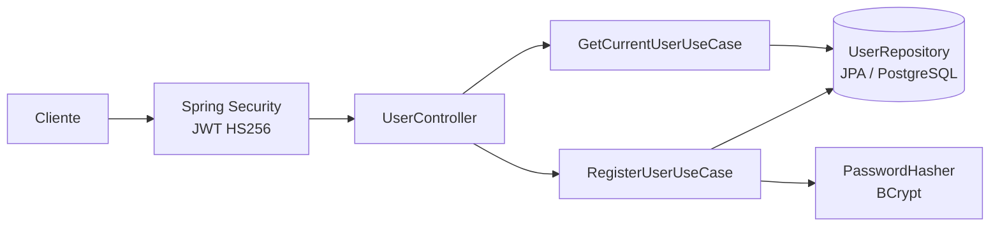

# Manual — task-api

> Última atualização: 2026-11-26 · 3c80b4b (+ alterações não commitadas da branch `feat/user-registration`)

## 1. Visão geral

API REST de gerenciamento de tarefas com autenticação JWT. Cada usuário gerencia apenas as próprias tarefas. **Hoje está implementado apenas o cadastro de usuário e a consulta do usuário autenticado**; login, refresh token, logout, troca de senha e tarefas estão planejados (ver CLAUDE.md, seção Domínio) e não existem no código.

Conceitos centrais: *usuário* (nome, email único, senha com hash BCrypt) e *token de acesso* (JWT HS256 enviado como `Authorization: Bearer`).

O contrato campo a campo está no Swagger UI (`/swagger-ui.html`, disponível só no perfil `dev`).

## 2. Como usar

### Cadastrar um usuário

```bash
curl -i -X POST http://localhost:8080/api/auth/register \
  -H 'Content-Type: application/json' \
  -d '{"name":"Maria Souza","email":"Maria.Souza@Example.com","password":"s3nha-segura"}'
```

Resposta `201` com `Location: /api/users/me` e o corpo (email devolvido em minúsculas, sem senha):

```json
{ "id": "3f6c2a9e-8d1b-4c7a-9f0e-2b5d6a7c8e91", "name": "Maria Souza",
  "email": "maria.souza@example.com", "createdAt": "2026-11-26T14:30:00Z" }
```

### Consultar o usuário autenticado

```bash
curl -i http://localhost:8080/api/users/me -H 'Authorization: Bearer <token>'
```

**Limitação atual:** não há endpoint que emita tokens (login/refresh são planejados). A infraestrutura de validação de JWT já existe, mas na prática só é possível chamar `/api/users/me` com um token HS256 assinado com o mesmo segredo e com `sub` igual ao id do usuário. O endpoint de login é a próxima etapa do desenvolvimento.

## 3. Funcionalidades

### Cadastrar usuário

**O que faz:** cria um usuário com nome, email e senha.

**Como usar:** `POST /api/auth/register` (público; Swagger, tag "Usuários").

**Regras de negócio:**
- Nome obrigatório, até 100 caracteres; espaços nas pontas são removidos — `RegisterUserRequest`, `User#User`
- Email obrigatório, formato válido, até 254 caracteres — `RegisterUserRequest`
- Email é normalizado (trim + minúsculas) antes de qualquer consulta ou gravação — `Email`
- Email é único; consulta prévia retorna 409 — `RegisterUserUseCase#execute`
- Cadastros simultâneos com o mesmo email: a restrição única `uk_users_email` do banco é a garantia final e também resulta em 409 — `JpaUserRepository#save`
- Senha obrigatória, 8 a 72 caracteres (limite do BCrypt) — `RegisterUserRequest`
- A senha é gravada somente como hash BCrypt; a resposta nunca a expõe (nem o hash) — `BCryptPasswordHasher`, `UserResponse`
- `id` é um UUID gerado pela aplicação; `createdAt` vem do relógio do servidor (UTC) — `User#register`, `RegisterUserUseCase`

**Erros** (corpo no formato ProblemDetail, RFC 9457):

| Status | Quando |
|---|---|
| 400 | Campo ausente, em branco, fora dos limites ou email inválido |
| 409 | Email já cadastrado (inclusive em cadastros concorrentes) |

**Eventos e integrações:** nenhum.

### Consultar usuário autenticado

**O que faz:** devolve id, nome, email e data de criação do dono do token.

**Como usar:** `GET /api/users/me` com `Authorization: Bearer <token>` (Swagger, tag "Usuários").

**Regras de negócio:**
- O usuário é identificado pelo `sub` do JWT, que deve ser um UUID — `UserController#me`
- Token ausente, inválido (assinatura) ou expirado é rejeitado pela segurança antes do controller — `SecurityConfig#securityFilterChain`
- Se o usuário do token não existe mais, retorna 404 — `GetCurrentUserUseCase#execute`

**Erros:**

| Status | Quando |
|---|---|
| 401 | Token ausente, inválido ou expirado |
| 404 | Usuário do token não existe mais |

**Eventos e integrações:** nenhum.

## 4. Funcionamento interno

Organização por feature (`user`) com camadas `api`, `application`, `domain` e `infrastructure`; código compartilhado em `shared`.



- **Segurança** (`SecurityConfig`): sem estado (sem sessão), CSRF desabilitado, JWT validado como resource server. Rotas públicas: `POST /api/auth/register`, `POST /api/auth/login`, `POST /api/auth/refresh` (as duas últimas ainda sem implementação), `GET` de Swagger/api-docs e `/actuator/health`, e `/error`. Todo o resto exige token.
- **Erros** (`GlobalExceptionHandler`): exceções de domínio estendem `NotFoundException` (404), `ConflictException` (409) ou `BusinessRuleException` (422); validação de entrada gera 400.
- **Persistência:** `spring.jpa.hibernate.ddl-auto=validate`; o esquema vem exclusivamente das migrations Flyway. Lock otimista via coluna `version`.
- Sem mensageria, jobs agendados ou integrações externas.

## 5. Configuração

| Variável / propriedade | Para que serve | Default | Obrigatória |
|---|---|---|---|
| `JWT_SECRET` (`app.jwt.secret`) | Segredo de assinatura HS256; mínimo 32 caracteres, senão a aplicação não sobe | nenhum (no perfil `dev` há um segredo de desenvolvimento) | Sim, fora do `dev` |
| `app.jwt.access-token-ttl` | Validade do token de acesso | `15m` | Não |
| `app.jwt.refresh-token-ttl` | Validade do refresh token (configurada; refresh ainda não implementado) | `7d` | Não |
| `springdoc.api-docs.enabled` | Expõe `/v3/api-docs` | `false` (`true` no `dev`) | Não |
| `springdoc.swagger-ui.enabled` | Expõe `/swagger-ui.html` | `false` (`true` no `dev`) | Não |

**Perfis:**
- `dev`: ativado automaticamente por `./mvnw spring-boot:run`; define um segredo JWT de desenvolvimento (nunca usar fora do ambiente local) e habilita Swagger e api-docs.
- Sem perfil (padrão/produção): `JWT_SECRET` obrigatório; Swagger e api-docs desligados.

## 6. Operação

- **Subir:** `./mvnw spring-boot:run` (sobe o `compose.yaml` e ativa o perfil `dev`). Só dependências: `docker compose up -d`.
- **Banco:** PostgreSQL 18 (`compose.yaml`, serviço `postgres`, banco/usuário `taskapi`; a porta 5432 do contêiner é publicada em porta aleatória do host).
- **Migrations:** Flyway executa na inicialização. `V1__create_users.sql` cria a tabela `users` (id UUID, name, email, password_hash, created_at, version) com a restrição única `uk_users_email`.
- **Problemas comuns:**
  - Falha na inicialização por `app.jwt.secret` inválido: defina `JWT_SECRET` com 32+ caracteres (ou rode com o perfil `dev` localmente).
  - Swagger retorna 404/401 fora do `dev`: é intencional, está desligado.
- Observabilidade: `GET /actuator/health` (público) responde `{"status":"UP"}` quando a aplicação e o banco estão saudáveis.

## 7. Glossário

- **Token de acesso:** JWT HS256 cujo `sub` é o id do usuário; validade padrão de 15 minutos.
- **Refresh token:** token de renovação (7 dias); planejado, ainda não implementado.
- **Email normalizado:** email sem espaços nas pontas e em minúsculas; base da unicidade.
- **ProblemDetail:** formato padrão (RFC 9457) das respostas de erro.

## 8. Registro de alterações

- 2026-11-26 — 3c80b4b (não commitado) — Criação do manual: cadastro de usuário, consulta do usuário autenticado, segurança JWT e configuração por perfil.
